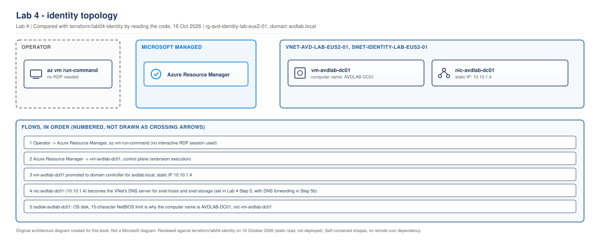

> **Part of:** [Azure Virtual Desktop - Architect to Hands-on Implementation](../README.md)
> **Chapter:** [Chapter 7 - Identity Architecture Foundations](../chapters/ch07-identity-architecture-foundations.md)
> **Terraform:** [`terraform/lab04-identity`](../terraform/lab04-identity/)
> **Technical baseline:** Microsoft Learn as retrieved 16 and 17 October 2026 (see [Review register](../REVIEW-REGISTER.md))
> **Status:** not executed. Implementation validation is pending. See the [Labs 3 to 8 journey guide](JOURNEY-LABS-3-8.md).

# LAB 4 - Identity Integration

> **LAB ARCHITECTURE** - the environment you build across Labs 1 to 20. Not a Microsoft reference design.

## Objective

Deploy a domain controller into the identity subnet, promote it, point the VNet at it for DNS, and prove that name resolution works. This gives you the AD DS join model used from Lab 8 onwards (the hosts are AD DS joined, not Microsoft Entra hybrid joined).

You build the DC even though [Chapter 7](../chapters/ch07-identity-architecture-foundations.md) argues that many designs no longer need one. There are two reasons. Most enterprise environments you will work in have this model, and you cannot properly understand what Entra Kerberos removes until you have seen what it replaces.

---

## ⚠️ Cost warning. Read this before you start.

This is the first lab with running compute cost (Lab 3 is $0.00 base; see its cost summary).

| Resource | Size | Running cost | Deallocated cost |
|---|---|---|---|
| Domain controller VM | Standard_B2s (2 vCPU, 4 GB) | ~$30 to $60 per month (approximate; the Windows licence is included in the VM price, so Windows costs more than a Linux figure) | $0 for compute |
| OS managed disk | 127 GB Standard SSD (E10) | ~$10 per month | ~$10 per month, disks bill whether or not the VM runs |
| Network interface, static private IP | | $0 | $0 |
| **Total if left running 24/7** | | **~$40 to $70 per month** | |
| **Total if deallocated between sessions** | | | **~$10 per month** |

All prices in this lab are approximate and were not re-verified in the October 2026 review; check the Azure pricing calculator. A Standard_D2s_v5 would cost noticeably more per month running. B2s is enough for a lab domain controller with a handful of objects. Do not size a production DC this way.

**The rule for the rest of this book: deallocate compute when you finish a session.** Stopping a VM from inside Windows does not stop billing. You must deallocate it from Azure.

```bash
# Deallocate at the end of every lab session
az vm deallocate \
  --resource-group rg-avd-identity-lab-eus2-01 \
  --name vm-avdlab-dc01

# Start it again next session
az vm start \
  --resource-group rg-avd-identity-lab-eus2-01 \
  --name vm-avdlab-dc01
```

**Keep this VM.** Labs 5, 6, 8 and 12 all depend on it. Deallocate it, do not delete it.

---

## Lab architecture

> **OUR ORIGINAL ARCHITECTURE DIAGRAM.** Created for this book. Not a Microsoft diagram.
> Editable source: [`lab04-identity-topology.drawio`](../diagrams/architecture/lab04-identity-topology.drawio)



One domain controller with a static private IP and no public IP. All configuration goes through Azure Resource Manager using `az vm run-command`, so no management port is exposed. Dotted components are built in later labs and are not created here.

---

## Prerequisites

- [Lab 3](lab-03-vnet-subnets-nsg-dns.md) complete. VNet and subnets exist
- Terraform initialised against your azurerm backend
- A strong local administrator password ready. It goes in `terraform.tfvars`, which is gitignored
- **Decide your path now, not at Step 7.** The Lab 8 Step 5 sign-in needs a test Entra tenant with a **verified custom domain**, Hybrid Identity Administrator in it, and Entra Cloud Sync from Step 7. Without them you can finish Labs 4 to 8 up to host registration, but not a user sign-in. The three paths are in the [journey guide](JOURNEY-LABS-3-8.md#1-choose-your-path-before-you-start)
- **Plan for an interactive session on the DC.** Steps 2 to 7 here use `az vm run-command`, but Lab 5 Steps 4 to 6 need an interactive session and this lab deploys no RDP path. The [journey guide](JOURNEY-LABS-3-8.md#3-hidden-dependency-an-interactive-session-on-the-domain-controller) lists the options. Azure Bastion Developer is free and lists East US 2 as supported (Learn, 17 October 2026, not tested here)

## Lab design decisions

Two choices in this lab are deliberate and worth understanding.

**No public IP address and no dedicated Azure Bastion host.** The DC has no public exposure at all. You configure it in this lab entirely through `az vm run-command`, which sends PowerShell to the VM through the Azure control plane. No RDP, no inbound rules, no Bastion cost. This is also a good habit. Production domain controllers should not have public IPs.

**Static private IP.** A domain controller's IP becomes the DNS server for the whole VNet. It cannot change. Terraform sets it explicitly to `10.10.1.4`, the first usable address in the identity subnet.

---

## Step 1 - Deploy the VM with Terraform

Full configuration is in [`terraform/lab04-identity`](../terraform/lab04-identity/). The important parts:

```hcl
resource "azurerm_network_interface" "dc" {
  name                = "nic-avdlab-dc01"
  location            = var.location
  resource_group_name = var.identity_resource_group_name

  ip_configuration {
    name                          = "internal"
    subnet_id                     = data.azurerm_subnet.identity.id
    private_ip_address_allocation = "Static"
    private_ip_address            = var.dc_private_ip
  }

  tags = local.common_tags
}

resource "azurerm_windows_virtual_machine" "dc" {
  name                  = "vm-avdlab-dc01"
  computer_name         = "AVDLAB-DC01"
  location              = var.location
  resource_group_name   = var.identity_resource_group_name
  size                  = var.dc_vm_size
  admin_username        = var.dc_admin_username
  admin_password        = var.dc_admin_password
  network_interface_ids = [azurerm_network_interface.dc.id]

  os_disk {
    caching              = "ReadWrite"
    storage_account_type = "StandardSSD_LRS"
  }

  source_image_reference {
    publisher = "MicrosoftWindowsServer"
    offer     = "WindowsServer"
    sku       = "2022-datacenter-azure-edition"
    version   = "latest"
  }

  tags = local.common_tags
}
```

**Why `computer_name` is set separately.** Windows computer names have a 15 character limit. The Azure resource name follows the book's convention, and the Windows name is kept short enough to be valid. This bites people at Lab 8 when session host names are generated automatically.

**Why Standard SSD and not Premium.** A lab DC does almost no IO. Premium SSD would roughly triple the disk cost for no benefit. Production DCs are a different conversation.

```bash
cd terraform/lab04-identity
cp terraform.tfvars.example terraform.tfvars
# edit terraform.tfvars: set owner and dc_admin_password
terraform init
terraform fmt
terraform validate
terraform plan -out=tfplan
terraform apply tfplan
```

**Expected output:** network interface and virtual machine created. Deployment takes three to five minutes.

**Common errors:**

- *Password does not meet complexity requirements.* Azure requires 12 to 123 characters with three of: lowercase, uppercase, digit, special character.
- *Quota exceeded.* Go back to [Lab 1 Step 3](lab-01-azure-prerequisites-and-tooling.md) and request an increase.
- *Subnet not found.* The data source is reading Lab 3's output. Confirm the VNet and subnet names match.

---

## Step 2 - Install the AD DS role

Everything in this lab from here uses `az vm run-command`. No RDP session is needed in Lab 4. Lab 5 does need one (see Prerequisites).

```bash
az vm run-command invoke \
  --resource-group rg-avd-identity-lab-eus2-01 \
  --name vm-avdlab-dc01 \
  --command-id RunPowerShellScript \
  --scripts "Install-WindowsFeature -Name AD-Domain-Services -IncludeManagementTools"
```

**What this does:** installs the Active Directory Domain Services role and the management tools. It does not promote the server yet.

**Expected output:** JSON containing `Success` and `RestartNeeded : No`.

**How long:** one to two minutes. `run-command` has a timeout, so if it returns nothing, run the check again rather than assuming failure.

---

## Step 3 - Promote to a domain controller

This creates a new forest. The lab domain is `avdlab.local`.

```bash
az vm run-command invoke \
  --resource-group rg-avd-identity-lab-eus2-01 \
  --name vm-avdlab-dc01 \
  --command-id RunPowerShellScript \
  --scripts "\$securePassword = ConvertTo-SecureString 'ReplaceWithYourDsrmPassword1!' -AsPlainText -Force; Install-ADDSForest -DomainName 'avdlab.local' -DomainNetbiosName 'AVDLAB' -SafeModeAdministratorPassword \$securePassword -InstallDns -Force -NoRebootOnCompletion:\$false"
```

**What this does:** creates a new AD forest, installs and configures the DNS role, sets the Directory Services Restore Mode password, and reboots.

**Passwords in this lab.** The `ReplaceWith...` strings are placeholders for throwaway lab credentials. Do not reuse a real password: script text sent through `az vm run-command` lands in your shell history and may be visible to anyone who can read the VM's run command resources or activity. `[VERIFY BEFORE IMPLEMENTATION]` Use a secret store for anything beyond a disposable lab.

**A note on the domain name.** `.local` is used here because this is a disconnected lab. For production, use a subdomain of a domain you own, such as `ad.contoso.com`. Do not use `.local` in production, and do not use the same name as your public domain.

**Expected behaviour:** the command may return an error or time out because the VM reboots while it is running. That is normal. Wait three to five minutes, then verify.

**Common errors:**

- *DSRM password complexity.* Same rules as the admin password.
- *The command appears to hang.* The reboot killed the connection. Wait and verify rather than re-running the promotion.

---

## Step 4 - Verify the promotion

```bash
az vm run-command invoke \
  --resource-group rg-avd-identity-lab-eus2-01 \
  --name vm-avdlab-dc01 \
  --command-id RunPowerShellScript \
  --scripts "Get-ADDomain | Select-Object DNSRoot, NetBIOSName, DomainMode; Get-Service ADWS, DNS, NTDS | Select-Object Name, Status"
```

**Expected output:** `DNSRoot : avdlab.local`, `NetBIOSName : AVDLAB`, and all three services showing `Running`.

If `Get-ADDomain` errors, the promotion did not complete. Check the Windows System and Directory Service event logs before re-running anything.

---

## Step 5 - Point the VNet at the domain controller

This is the step that breaks environments when it is done in the wrong order. Only do it now that Step 4 has passed.

```bash
az network vnet update \
  --resource-group rg-avd-network-lab-eus2-01 \
  --name vnet-avd-lab-eus2-01 \
  --dns-servers 10.10.1.4
```

**What this does:** every VM in the VNet will now receive `10.10.1.4` as its DNS server through DHCP.

**Then restart the VMs.** VMs cache DNS settings from DHCP and will not pick up the change until they restart. Learn says the same: VMs and other resources that inherit DNS servers keep their current settings until they restart ([Create, change, or delete a virtual network](https://learn.microsoft.com/azure/virtual-network/manage-virtual-network), Change DNS servers, retrieved 17 October 2026). Session hosts you create in Lab 8 are created after this step and pick the setting up at deployment.

```bash
az vm restart \
  --resource-group rg-avd-identity-lab-eus2-01 \
  --name vm-avdlab-dc01
```

**Why the DC itself needs restarting too:** it is a VM in the same VNet and it also caches its DNS setting.

**The mistake to avoid.** Do not set VNet DNS before the DC is resolving. If you do, every VM in the VNet loses name resolution, including the DC while it is mid-configuration. If that happens, set the DNS servers back to empty, restart, fix the DC, and try again.

> **Re-applying Lab 3 afterwards (U24, open).** The Lab 3 module has no `dns_servers` argument. Whether `terraform apply` there would reset the DNS server you just set is **not verified**. Run `terraform plan` in `terraform/lab03-network` and read it before any apply. Two documented options if it shows a reset, both `[UNTESTED]`: (1) add `lifecycle { ignore_changes = [dns_servers] }` to `azurerm_virtual_network.avd` (a standard Terraform meta-argument; the module was not changed); or (2) manage the setting with the separate `azurerm_virtual_network_dns_servers` resource, which exists in the provider (Learn's provider history records it from AzureRM 2.69.0). Do not combine both ways of setting DNS on one VNet without testing. Test plan: `reviews/TEST-PLANS.md`, U24.

> **Terraform note.** This lab sets DNS with the CLI so that you can see the ordering clearly. In production this belongs in Terraform, on the `azurerm_virtual_network` resource using the `dns_servers` argument. The reason it is not in the Terraform here is that Terraform would try to set it during the same apply that creates the DC, before the DC exists. Ordering problems like this are exactly why some steps stay imperative. [Project 03](../scenarios/project-03-global-enterprise-governance.md) covers how to handle this properly with separate applies at scale.

---

## Step 5b - Forward Azure names from the domain controller to Azure DNS

Added in the 16 October 2026 review. Once the VNet uses the domain controller as its DNS server, Azure private DNS zones linked to the VNet are no longer consulted automatically. Microsoft Learn says that if your custom DNS server is a VM, you must configure a conditional forwarder that points to Azure DNS (`168.63.129.16`) for the private zone. Lab 5 depends on this, because the storage account name must resolve to the private endpoint address from every host and from the domain controller itself.

```bash
az vm run-command invoke \
  --resource-group rg-avd-identity-lab-eus2-01 \
  --name vm-avdlab-dc01 \
  --command-id RunPowerShellScript \
  --scripts "Add-DnsServerConditionalForwarderZone -Name 'file.core.windows.net' -MasterServers 168.63.129.16 -ForwarderTimeout 5; Set-DnsServerForwarder -IPAddress 168.63.129.16 -Timeout 5; Get-DnsServerZone -Name 'file.core.windows.net' | Format-List *; Get-DnsServerForwarder | Format-List *"
```

**What this does:** creates a conditional forwarder for the Azure Files namespace with a 5 second forwarder timeout, and sets a server-level forwarder to Azure DNS, also with a 5 second timeout, so public Azure and internet names resolve through Azure DNS rather than only through root hints. **`Set-DnsServerForwarder -IPAddress` overwrites any existing server-level forwarders**, so read `Get-DnsServerForwarder` first if this DC has been configured before. The parameters are confirmed in Learn's DnsServer module reference (`-ForwarderTimeout` on `Add-DnsServerConditionalForwarderZone`, `-Timeout` on `Set-DnsServerForwarder`, retrieved 17 October 2026). The command was not executed. `[VERIFY BEFORE IMPLEMENTATION]` Read the `Format-List *` output for the timeout properties, then run `Resolve-DnsName` against a public name before moving on. Expected, if it works: the zone and forwarder are listed with the Azure DNS address, and a public name resolves.

**Zone name (Learn pages differ).** This lab forwards `file.core.windows.net`, the Azure Files namespace, which matches the Azure Files site-to-site VPN page and the Private Endpoint DNS integration page's advice to forward the public zone rather than `privatelink.*`. The "Configure DNS forwarding for Azure Files" page instead forwards the whole storage suffix, `core.windows.net`, and warns that doing so breaks access to private-endpoint storage accounts in other tenants. A troubleshooting page for custom DNS on domain controllers shows a `privatelink.*` forwarder. Learn does not reconcile these. Judgement: the narrower `file.core.windows.net` zone avoids the cross-tenant warning and covers this lab, and the lab never uses blob or other storage endpoints. Tracked in U27.

**Forwarding timeout (Learn, retrieved 17 October 2026).** Learn says that when Windows DNS servers forward to Azure DNS, the forwarding timeout should be more than four seconds so Azure's recursive resolvers can finish, and that too short a timeout can make private DNS zone names resolve to public IP addresses ([Configure DNS name resolution for Azure virtual networks](https://learn.microsoft.com/azure/virtual-network/virtual-networks-name-resolution-for-vms-and-role-instances), Name resolution that uses your own DNS server). The command above sets 5 seconds on both the conditional forwarder zone and the server-level forwarder. Learn's forwarding page lists these as separate settings (`ForwarderTimeout` for conditional forwarder zones, `ForwardingTimeout` for server-level forwarders), so check both in the `Format-List *` output. Also per that page, once custom DNS servers are set, port 53 traffic bypasses the subnet and NIC NSGs, and if a VPN gateway is later used with custom DNS, the Azure DNS IP must stay in the VNet DNS list. Not executed (U27).

**Common error:** a forwarder already exists. Read the list with `Get-DnsServerForwarder` first.

---

## Step 6 - Create test users and groups

These are used from Lab 16 onwards for assignment testing (Labs 11-20 build a second, centralus-based identity and a non-overlapping group assignment pattern across both regions - see the [Labs 11-20 plan](../appendices/labs-11-20-plan.md)).

```bash
az vm run-command invoke \
  --resource-group rg-avd-identity-lab-eus2-01 \
  --name vm-avdlab-dc01 \
  --command-id RunPowerShellScript \
  --scripts "New-ADOrganizationalUnit -Name 'AVD' -Path 'DC=avdlab,DC=local'; New-ADOrganizationalUnit -Name 'Users' -Path 'OU=AVD,DC=avdlab,DC=local'; New-ADOrganizationalUnit -Name 'SessionHosts' -Path 'OU=AVD,DC=avdlab,DC=local'; New-ADGroup -Name 'AVD-Task-Users' -GroupScope Global -Path 'OU=Users,OU=AVD,DC=avdlab,DC=local'; \$pw = ConvertTo-SecureString 'ReplaceWithYourUserPassword1!' -AsPlainText -Force; 1..3 | ForEach-Object { New-ADUser -Name \"avdtest0\$_\" -SamAccountName \"avdtest0\$_\" -UserPrincipalName \"avdtest0\$_@avdlab.local\" -AccountPassword \$pw -Enabled \$true -Path 'OU=Users,OU=AVD,DC=avdlab,DC=local'; Add-ADGroupMember -Identity 'AVD-Task-Users' -Members \"avdtest0\$_\" }"
```

**What this does:** creates an OU structure, one group, and three test users in that group.

**Why a separate OU for session hosts:** so that GPO can be scoped to them without affecting anything else. Labs 4 to 8 do not use it: Lab 8 joins the host with an empty `OUPath`, so it lands in the default Computers container, and FSLogix is configured through the registry in Lab 8. The OU is kept for later GPO scoping.

**Verify:**

```bash
az vm run-command invoke \
  --resource-group rg-avd-identity-lab-eus2-01 \
  --name vm-avdlab-dc01 \
  --command-id RunPowerShellScript \
  --scripts "Get-ADUser -Filter * -SearchBase 'OU=Users,OU=AVD,DC=avdlab,DC=local' | Select-Object Name, UserPrincipalName; Get-ADGroupMember -Identity 'AVD-Task-Users' | Select-Object Name"
```

**Expected output:** three users listed, all three shown as members of the group.

---

## Step 7 - Identity synchronisation: the selected design and its limits

**Selected design for Labs 4 to 8: AD DS joined session hosts with synchronised hybrid identities.** [Chapter 7](../chapters/ch07-identity-architecture-foundations.md#1-start-with-the-rule-that-applies-to-everyone) established that users of AD DS joined session hosts must exist in both AD DS and Microsoft Entra ID. Lab 4 builds only the AD DS half. This step is the other half, and it is **required before Lab 8 Step 5 (sign in through Windows App) can succeed**. Labs 4 to 8 up to that point (domain join, Azure Files join, FSLogix configuration, host registration) do not need it.

**Prerequisites for this step** (Learn: [Prerequisites for Microsoft Entra Cloud Sync](https://learn.microsoft.com/entra/identity/hybrid/cloud-sync/how-to-prerequisites) and [Prepare a nonroutable domain for directory synchronization](https://learn.microsoft.com/microsoft-365/enterprise/prepare-a-non-routable-domain-for-directory-synchronization), retrieved 16 October 2026):

| Need | Why |
|---|---|
| A dedicated **test Entra tenant** with a **verified custom domain** | A `.local` UPN cannot be verified. Without a verified suffix the account syncs to an `.onmicrosoft.com` UPN |
| An alternative UPN suffix for that domain added in AD (Active Directory Domains and Trusts) and `avdtest01..03` UPNs changed to it | This is Learn's documented fix for `.local` forests |
| A Hybrid Identity Administrator account in the tenant (not a guest) | Required to configure Cloud Sync |
| Domain Admin or Enterprise Admin credentials in `avdlab.local` | Needed to create the agent's gMSA |
| Provisioning agent on a domain-joined server (installing on the DC is supported) with outbound access | Cloud Sync uses an outbound-only agent |
| Schema attribute `msDS-ExternalDirectoryObjectId` | Windows Server 2016 or later has it |

Then sync only `OU=Users,OU=AVD` with Entra Cloud Sync and confirm the three users appear in the tenant. Put a synced group in the Lab 5/7 `avd-lab-users` role assignments so share-level RBAC (Lab 5) and the application group assignment (Lab 7) match real Entra identities.

**Limitations of this design.** It needs a tenant and domain you control and can write to. It is `[UNTESTED]`: no sync, agent install or sign-in was run for this repository. Cloud Sync has its own supported-topology limits, and Microsoft Entra Connect Sync is the alternative if you need a feature Cloud Sync lacks. Check both against current Learn before use.

**If you cannot sync (no test tenant).** Labs 4 to 8 still complete up to the Lab 8 sign-in step. For an end-to-end sign-in, use the Entra-only path in [Project 05](../scenarios/project-05-entra-only-cloud-native.md), which covers Entra joined hosts (profile storage with Microsoft Entra Kerberos is covered in Chapter 20; cloud-only identities are supported for FSLogix on Azure Files in the public cloud, per Learn's [profile container with Microsoft Entra ID](https://learn.microsoft.com/azure/virtual-desktop/create-profile-container-azure-ad)). That path replaces Labs 4 and 5's AD DS steps rather than extending them.

Tracked as U30 and U32.

---

## Validation Checklist

- [ ] VM `vm-avdlab-dc01` deployed with no public IP address
- [ ] Private IP is exactly `10.10.1.4` and set to Static
- [ ] `Get-ADDomain` returns `avdlab.local`
- [ ] ADWS, DNS and NTDS services all Running
- [ ] VNet DNS servers set to `10.10.1.4`
- [ ] DC restarted after the DNS change
- [ ] Conditional forwarder for `file.core.windows.net` and the Azure DNS forwarder present on the DC, both with a timeout above four seconds (Step 5b)
- [ ] Path decided: full sign-in (Step 7 completed), infrastructure only, or Entra-only. See the [journey guide](JOURNEY-LABS-3-8.md)
- [ ] OU structure created: `OU=AVD`, with `Users` and `SessionHosts` beneath it
- [ ] Three test users created and in the `AVD-Task-Users` group
- [ ] All resources tagged with the seven standard tags
- [ ] `terraform plan` reports no changes after apply
- [ ] **VM deallocated at the end of the session**

## Troubleshooting

| Problem | Likely cause | Fix |
|---|---|---|
| `run-command` returns nothing | VM rebooting, or the command exceeded the timeout | Wait, then run a verification command rather than repeating the action |
| `Get-ADDomain` fails after promotion | Promotion did not finish | Check the Directory Service event log before re-running |
| Other VMs cannot resolve `avdlab.local` | VMs not restarted after the DNS change | Restart them. DNS comes from DHCP and is cached |
| Domain join fails in Lab 8 | VNet DNS not pointing at the DC, or the DC is deallocated | Check both. A deallocated DC is the most common cause |
| A Lab 3 plan wants to change `dns_servers` | The VNet DNS was set outside Terraform (U24) | Do not apply. See the Step 5 re-apply note |
| A storage name resolves to a public IP from a host | Forwarder missing, timeout of four seconds or less, or hosts not restarted after the DNS change | `Get-DnsServerForwarder`, `Format-List *` on the zone, restart the host |
| Terraform wants to replace the VM | `source_image_reference` version drift or a size change | Read the plan carefully. Replacing a promoted DC means rebuilding the domain |
| Password rejected | Complexity rules | 12 to 123 characters, three of the four character classes |

## Cleanup

**Do not delete this VM.** Labs 5, 6, 8 and 12 depend on it.

**Do deallocate it at the end of every session.** If you created a `labadmin` account or a Bastion Developer connection for the journey guide, remove them when you finish the whole sequence (see the [journey guide, section 7](JOURNEY-LABS-3-8.md#7-cost-and-cleanup)).

```bash
az vm deallocate \
  --resource-group rg-avd-identity-lab-eus2-01 \
  --name vm-avdlab-dc01
```

Running cost drops to the disk only, about $10 per month. Over the rest of the book that is the difference between roughly $40 and roughly $10 per month for this component alone. Get into the habit now, because Lab 8 adds session hosts and the same discipline saves considerably more there.

## Lab 4 Interview Questions

**Q. Where would you place domain controllers for an AVD deployment?**
At least one in every region where session hosts run, in a dedicated subnet, with no public IP. The reason is logon latency and failure isolation. If session hosts in one region have to authenticate across a WAN link to another region, logon time becomes unpredictable and a single link failure takes down desktops that are otherwise healthy. I would also use static private IPs, because those addresses become the VNet DNS servers and cannot move.

**Q. Why does the order matter when changing VNet DNS?**
Because every VM in the VNet gets its DNS server from DHCP. If you point the VNet at a DC that is not yet resolving, everything in that VNet loses name resolution, including the DC while it is being configured. Promote and verify the DC first, then change VNet DNS, then restart the VMs so they pick up the new setting.

**Q. You configured this domain controller without ever opening RDP. Why does that matter?**
Because a domain controller with a public IP is an unnecessary attack surface, and adding Bastion just for setup would have cost about $140 a month. `az vm run-command` sends PowerShell through the Azure control plane, so configuration goes through Azure RBAC and the activity log instead of an open port. It is the same reason AVD itself uses reverse connect. Keep the management path off the network path.

---

## What comes next

[Chapter 8](../chapters/ch08-authentication-flows-in-detail.md) explains the authentication stages in an AVD connection. **Lab 5 builds profile storage** and uses the identity foundation from this lab.

**Before you close this session, deallocate the VM.**
