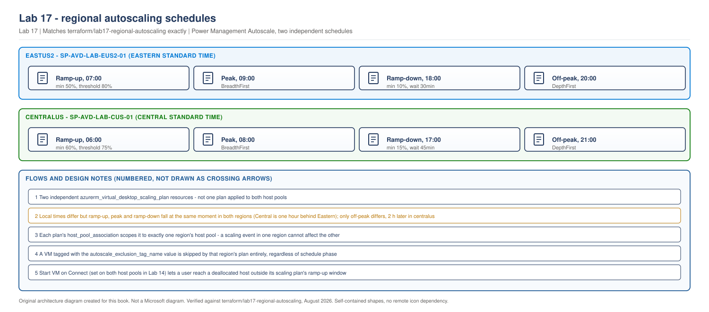

> **Part of:** [Azure Virtual Desktop - Architect to Hands-on Implementation](../README.md)
> **Chapter:** [Chapter 15 - Host Pool Design Decisions](../chapters/ch15-host-pool-design-decisions.md)
> **Terraform:** [`terraform/lab17-regional-autoscaling`](../terraform/lab17-regional-autoscaling/)
> **ADR:** [Standard host-pool management and Power Management Autoscale](../appendices/adr-shc-vs-standard-host-pools.md)
> **Technical baseline:** August 2026
> **Plan:** [Labs 11-20 plan](../appendices/labs-11-20-plan.md)

# LAB 17 - Regional Autoscaling with Power Management Autoscale

> **LAB ARCHITECTURE** - the environment you build across Labs 1-20. Not a Microsoft reference design.

## Objective

Give each region's host pool its own independent scaling plan, tuned to that region's own demand pattern, using Power Management Autoscale, this book's required, production-safe implementation. Dynamic Autoscaling is covered as an optional comparison at the end of this lab, not deployed here. See the [ADR](../appendices/adr-shc-vs-standard-host-pools.md) for the full reasoning.

## Lab architecture

> **OUR ORIGINAL ARCHITECTURE DIAGRAM.** Created for this book. Not a Microsoft diagram.
> Editable source: [`lab17-regional-autoscaling-schedules.drawio`](../diagrams/architecture/lab17-regional-autoscaling-schedules.drawio)



## Cost summary

| | Impact |
|---|---|
| Scaling plan objects | **$0.00** - no direct charge |
| Effect on Lab 14's baseline | **Reduction, not addition** - Power Management Autoscale deallocates idle session hosts during ramp-down and off-peak, cutting compute charges during those windows |
| Estimated saving | Not measured in this lab, so no percentage is claimed. To measure it, compare the compute hours billed for Lab 14's always-on hosts with this lab's hosts over the same period, using your own cost data |

## Prerequisites

- Labs 7 and 14 complete, with `host_pool_id` outputs populated (both gained this output for this lab - re-run `terraform apply` once in each if you built them earlier)
- Lab 10's original single-region scaling plan removed or accepted as superseded, since this lab's `eastus2` plan replaces it for the active-active design

---

## Lab design decisions

**Two scaling plans, not one plan with region-conditional logic.** Same reasoning as Lab 16's group design: a single scaling plan trying to express two regions' different schedules through conditional logic would be harder to audit than two separate, statically-configured plans, each fully readable on its own.

**Two sets of schedule values, not a copy with the region name changed.** `centralus`'s plan is written in Central Standard Time and `eastus2`'s in Eastern Standard Time. The plans use different local times (ramp-up 06:00 versus 07:00), different minimum-hosts and capacity-threshold percentages, a longer ramp-down wait (45 versus 30 minutes) and a later off-peak start. Read the times with care: Central is one hour behind Eastern, so 06:00 Central and 07:00 Eastern are the same moment, and so are peak (08:00 Central, 09:00 Eastern) and ramp-down (17:00 Central, 18:00 Eastern). The two plans therefore ramp up, peak and start ramp-down together. In absolute time only off-peak differs, where `centralus` starts two hours later (21:00 Central, which is 22:00 Eastern, versus 20:00 Eastern). The percentages and wait times are the other real differences. They are deliberate placeholders for different demand assumptions per user cohort, to be replaced with real telemetry. This is clock arithmetic and assumes both time zones follow the same daylight-saving rules; how a scaling plan behaves across a daylight-saving change is not verified here.

---

## Step 1 - Deploy with Terraform

Full configuration is in [`terraform/lab17-regional-autoscaling/`](../terraform/lab17-regional-autoscaling/). The two plans side by side, showing the deliberate difference:

```hcl
# eastus2
schedule {
  ramp_up_start_time                 = "07:00"
  ramp_up_minimum_hosts_percent      = 50
  ramp_up_capacity_threshold_percent = 80
  ramp_down_start_time               = "18:00"
  ramp_down_wait_time_minutes        = 30
  off_peak_start_time                = "20:00"
}

# centralus - not the same numbers
schedule {
  ramp_up_start_time                 = "06:00"
  ramp_up_minimum_hosts_percent      = 60
  ramp_up_capacity_threshold_percent = 75
  ramp_down_start_time               = "17:00"
  ramp_down_wait_time_minutes        = 45
  off_peak_start_time                = "21:00"
}
```

```bash
cd terraform/lab17-regional-autoscaling
cp terraform.tfvars.example terraform.tfvars   # edit owner, primary_state_storage_account
terraform init
terraform fmt
terraform validate
terraform plan -out=tfplan
terraform apply tfplan
```

> This Terraform has not been run against a live Azure subscription while writing this lab. It has been checked for balanced syntax and built directly from Lab 10's already-applied scaling plan module, adapted to two regions with intentionally different schedule values. Confirm your own plan output before applying.

**Expected plan output, in shape:** 2 resources to add (one scaling plan per region), 0 to change, 0 to destroy.

## Step 2 - Confirm both plans are attached correctly

```bash
az desktopvirtualization scalingplan show \
  --resource-group rg-avd-service-lab-eus2-01 \
  --name sp-avd-lab-eus2-01 \
  --query "hostPoolReferences[0].hostPoolArmPath" \
  --output tsv
```

**Expected output:** the resource ID of `hp-avd-lab-eus2-01` (Lab 7's host pool), not `centralus`'s.

```bash
az desktopvirtualization scalingplan show \
  --resource-group rg-avd-service-lab-cus-01 \
  --name sp-avd-lab-cus-01 \
  --query "hostPoolReferences[0].hostPoolArmPath" \
  --output tsv
```

**Expected output:** the resource ID of `hp-avd-lab-cus-01` (Lab 14's host pool).

## Step 3 - Observe an independent scaling action per region

Because 17:00 Central and 18:00 Eastern are the same moment, the two plans start ramp-down together, so simultaneous scaling is expected here. What this step checks is that each plan acts on its own region's hosts and follows its own values where they differ (ramp-down wait, off-peak start, percentages). Record what you observe; do not infer independence from the configuration alone:

```bash
# Check eastus2 session host power state around its ramp-down window (18:00 Eastern, the same moment as 17:00 Central)
az vm list -g rg-avd-hosts-lab-eus2-01 -d --query "[].{name:name, powerState:powerState}" -o table

# Check centralus session host power state around its ramp-down window (17:00 Central)
az vm list -g rg-avd-hosts-lab-cus-01 -d --query "[].{name:name, powerState:powerState}" -o table
```

**Expected behaviour (from the configuration; not observed in this repo):** hosts in both regions begin scaling down at the same moment, 17:00 Central and 18:00 Eastern. The differences you can look for are the ramp-down wait (45 minutes in `centralus`, 30 in `eastus2`) and off-peak, which starts at 20:00 Eastern in `eastus2` but not until 21:00 Central (22:00 Eastern) in `centralus`, so for two hours only `eastus2` has reached off-peak. Recording the timestamps of each region's actual scaling action, not just the configured schedule, is the validation evidence this lab asks for. Configuration matching intent is necessary, but observing each plan act on its own region's hosts is the real proof.

---

## Validation Checklist

- [ ] `sp-avd-lab-eus2-01` exists, attached to `hp-avd-lab-eus2-01` only
- [ ] `sp-avd-lab-cus-01` exists, attached to `hp-avd-lab-cus-01` only
- [ ] The two plans' schedule values are confirmed different (minimum-hosts and capacity-threshold percentages, ramp-down wait time, off-peak start), not copies. The ramp-up, peak and ramp-down times differ on the clock but fall at the same moment
- [ ] An observed scaling action in each region, with timestamps, showing each plan acts on its own region's hosts and, where the values differ (wait time, off-peak start), follows its own values
- [ ] A VM tagged with the exclusion tag value confirmed skipped by that region's scaling action

## Troubleshooting

| Problem | Likely cause | Fix |
|---|---|---|
| `hostPoolReferences` empty on either plan | `host_pool_association` block missing or referencing the wrong host pool ID | Confirm the `hostpool_id` in each region's `.tf` file points at that region's own remote-state output, not the other region's |
| Both regions' hosts begin ramp-down at the same moment | Expected: 17:00 Central and 18:00 Eastern are the same moment, and ramp-up and peak also coincide. Only the off-peak start (20:00 Eastern versus 21:00 Central), the wait time and the percentages differ | Compare each plan's `time_zone` and schedule values with Step 1. Treat it as a fault only if the off-peak start, wait time and percentages are also identical, for example both regions using Lab 10's original numbers |
| Session host doesn't deallocate at the expected ramp-down time | An active session is preventing it (expected, matches `ramp_down_force_logoff_users = false`), or `ramp_down_wait_time_minutes` hasn't elapsed yet | Check for active sessions on that host before assuming a fault; the wait time is deliberate, not a bug |

## Cleanup

**Keep both scaling plans.** They reduce Lab 14's ongoing cost, which is the opposite of something to remove for cost reasons. No manual deallocation needed for this lab specifically - that's the whole point of building it.

---

## Optional: Dynamic Autoscaling as a comparison and future upgrade path

> **This section is informational only. Nothing here is deployed in this lab, and nothing in Labs 14-20 depends on it.**

**What it is, and how it differs from Power Management Autoscale.** Dynamic Autoscaling can create and delete session hosts, not just start and stop them, scaling the actual number of VMs in a pool up and down based on demand rather than cycling a fixed set of hosts through running and deallocated states. It requires a pooled host pool built with Session Host Configuration (Automated Host Pool), which this book's Labs 14-20 do not use, per the [ADR](../appendices/adr-shc-vs-standard-host-pools.md).

**What to check before relying on it.** Re-visit [`learn.microsoft.com/azure/virtual-desktop/autoscale-glossary`](https://learn.microsoft.com/en-us/azure/virtual-desktop/autoscale-glossary) for Dynamic Autoscaling's current status, and the SHC tooling status covered in Lab 14's optional section (Terraform provider support, the PowerShell module's preview state, the ARM API version) - Dynamic Autoscaling is only reachable once an SHC-based pool exists, so its own status is secondary to whether SHC itself has become genuinely deployable.

**This has not been deployed, Terraform-validated, or tested anywhere in this book.** It is documented here as the upgrade path this lab's design deliberately leaves open, not as a claim about what it does in practice.

---

## Lab 17 Interview Questions

**Q. Why do the two regions' scaling plans have their own schedule values instead of one shared set?**
Because copying one region's schedule into the other would be an unexamined default masquerading as a decision, and this book deliberately avoids that pattern elsewhere too. `centralus` and `eastus2` serve different user cohorts in this design, so each plan carries its own minimum-hosts and capacity-threshold percentages, ramp-down wait and off-peak start, to be tuned against that region's real telemetry. The clock times are not where the difference lies: because Central is one hour behind Eastern, the two plans' ramp-up, peak and ramp-down times fall at the same moment, and only off-peak differs in absolute time. Giving each region its own tuned values is what makes "regional autoscaling" a genuine design decision rather than a checkbox that happens to be ticked twice.

**Q. What would you actually check to confirm two scaling plans are truly independent, beyond reading their Terraform configuration?**
Configuration correctness proves intent, not behaviour. The real test is observing each plan act on its own region's hosts, with timestamps recorded, and, where the values differ, follow its own values: a different ramp-down wait, and an off-peak start two hours later in `centralus`. Because the two plans ramp down at the same moment, simultaneous scaling is not evidence of a shared dependency. If you only checked that the Terraform applied without error, you'd have confirmed the plans were created correctly, not that they actually operate independently at runtime. A shared dependency you didn't notice, like both plans accidentally pointing at the same host pool, would only show up in the behavioural test, not the configuration read.

**Q. Dynamic Autoscaling can create and delete hosts, which sounds more efficient than Power Management Autoscale's start-and-stop model. Why isn't it this lab's required implementation, given the Azure feature is GA?**
Because the Azure-side feature being GA doesn't mean every tool needed to build and depend on it safely is also ready, and Dynamic Autoscaling specifically requires a Session Host Configuration pool, which this book's research found isn't currently buildable with a stable Terraform resource, and whose PowerShell and ARM API paths are both still explicitly marked preview by Microsoft. Building a required lab dependency on three simultaneously-preview tooling paths, just to get a theoretically more efficient scaling model, is a worse trade than accepting Power Management Autoscale's real but smaller efficiency gap in exchange for a design that's fully GA and fully reproducible today. The upgrade path stays open and documented for when that changes.

---

## What comes next

[Lab 18 - Regional Security and Monitoring](lab-18-regional-security-monitoring.md) gives `centralus` its own egress control and its own Log Analytics workspace, joined by a cross-workspace dashboard, following the same per-region independence reasoning this lab and Lab 16 both apply.
